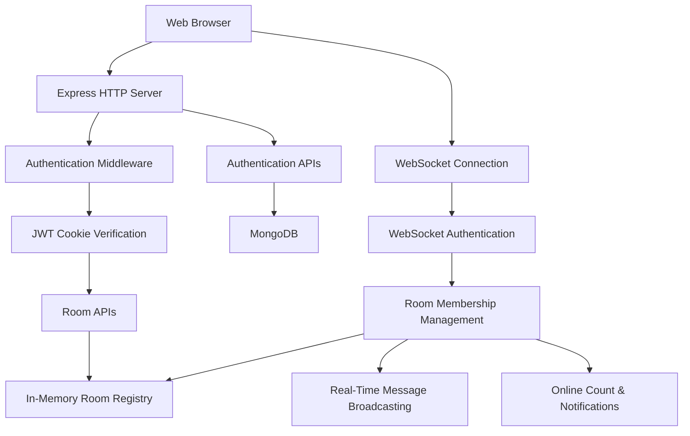

# 🦖 Raptor — Real-Time Chat Application

### A Room-Based Real-Time Messaging System Built with Node.js & WebSockets

🚀 Live Demo: https://raptor-chatapp.onrender.com/

**Raptor** is a real-time chat application designed to explore the engineering behind interactive communication systems. It combines secure authentication, room-based messaging, WebSocket communication, and backend room management, with a roadmap toward scalable, distributed real-time infrastructure.

The current version provides a working foundation for real-time communication. Future iterations will focus on Redis-based cross-instance communication, horizontal scaling, load balancing, and performance optimization.

> **Project Status:** Core application deployed · Scalability enhancements in progress

---

## ✨ Key Features

- **Secure User Authentication** — User registration and login with password hashing using bcrypt.
- **JWT-Based Authentication** — JSON Web Tokens for verifying authenticated users.
- **HTTP-Only Authentication Cookies** — Cookie-based token handling to reduce direct JavaScript access to authentication tokens.
- **Room Creation** — Create named chat rooms through authenticated HTTP APIs.
- **Room Joining** — Validate room existence before joining a conversation.
- **Real-Time Messaging** — Exchange messages between connected users using WebSockets.
- **Room-Based Communication** — Organize connected clients into separate rooms.
- **Live Online User Count** — Track connected users in a room and broadcast count updates.
- **Join & Leave Notifications** — Notify room participants when users enter or leave.
- **Connection Lifecycle Handling** — Handle WebSocket connections, disconnections, and room membership changes.
- **Persistent User Accounts** — Store user information in MongoDB.
- **Production Deployment** — Deploy the Node.js application on Render.

## 🛠️ Tech Stack

| Technology       | Purpose                                |
| ---------------- | -------------------------------------- |
| Node.js          | JavaScript runtime                     |
| Express.js       | HTTP server and REST APIs              |
| WebSocket (`ws`) | Real-time, bidirectional communication |
| MongoDB          | Persistent user data                   |
| Mongoose         | MongoDB object modeling                |
| JWT              | Authentication and token verification  |
| bcryptjs         | Password hashing                       |
| cookie-parser    | HTTP cookie parsing                    |
| dotenv           | Environment-based configuration        |
| Render           | Application deployment                 |

## 🏗️ Architecture

The current architecture separates ordinary HTTP operations from real-time communication.



### How It Works

1. **Authentication:** Users register or log in. Passwords are hashed before storage, and successful login issues a JWT in an HTTP-only cookie.
2. **Room Management:** Authenticated HTTP endpoints create rooms or validate existing rooms.
3. **WebSocket Connection:** The chat page establishes a WebSocket connection and authenticates using the cookie.
4. **Room Membership:** Authenticated clients join a room and are registered in the server's in-memory room registry.
5. **Real-Time Events:** Messages, online counts, and join/leave notifications are distributed to relevant connected clients.
6. **Disconnection Handling:** When a client disconnects, its room membership is removed and the room's online count is updated.

## 🔐 Authentication & Security

Raptor implements several foundational security practices:

- Password hashing with bcryptjs.
- JWT verification for authenticated requests.
- HTTP-only cookies for authentication tokens.
- Authentication middleware for protected HTTP endpoints.
- Server-side identity assignment for authenticated WebSocket users.
- Environment variables for sensitive configuration.

**Production security considerations:** HTTPS, secure cookie configuration, WebSocket origin validation, input validation, rate limiting, and abuse prevention are important parts of the ongoing hardening process.

## 📂 Project Structure

```text
raptor-chatapp/
├── controllers/
│   └── authController.js
├── middleware/
│   └── authMiddleware.js
├── models/
│   └── User.js
├── routes/
│   └── authRoutes.js
├── public/
│   ├── index.html
│   ├── rooms.html
│   ├── chat.html
│   ├── css/
│   │   ├── auth.css
│   │   ├── room.css
│   │   └── chat.css
│   └── js/
│       ├── auth.js
│       ├── rooms.js
│       └── chat.js
├── server.js
├── package.json
├── package-lock.json
└── .env
```

*The structure above describes the current organization; adjust individual filenames if your repository differs. The `.env` file should remain local and must not be committed.*

## 🚀 Getting Started

### Prerequisites

- Node.js and npm
- MongoDB instance or MongoDB Atlas account
- Git

### 1. Clone the Repository

```bash
git clone https://github.com/NANDGOPALSHARMA-29/raptor-rooms
cd raptor-chatapp
```

### 2. Install Dependencies

```bash
npm install
```

### 3. Configure Environment Variables

Create a `.env` file in the project root:

```env
PORT=3000
MONGO_URI=your_mongodb_connection_string
JWT_SECRET=your_strong_secret_key
NODE_ENV=development
```

Replace the placeholder values with your actual configuration. Never commit real credentials or secrets.

### 4. Start the Server

```bash
npm start
```

Open the local application at:

```text
http://localhost:3000
```

For deployment, configure `MONGO_URI` and `JWT_SECRET` in your hosting provider's environment settings. The application should use the hosting provider's assigned port when deployed.

## 📈 Scalability Roadmap

The long-term goal is to evolve Raptor from a single-instance chat application into a more scalable real-time messaging system.

### Phase 1 — Core Real-Time Chat ✅

- [x] User registration and login
- [x] JWT authentication
- [x] HTTP-only cookie authentication
- [x] Room creation and joining APIs
- [x] WebSocket-based messaging
- [x] Room-specific online counts
- [x] Join and leave notifications
- [x] Initial production deployment

### Phase 2 — Reliability & Security 🔄

- [ ] Validate and harden WebSocket origin handling
- [ ] Add rate limiting and message validation
- [ ] Improve error handling and connection cleanup
- [ ] Add structured logging
- [ ] Add automated tests for authentication, rooms, and messaging

### Phase 3 — Distributed Real-Time Architecture 📡

- [ ] Introduce Redis for cross-instance event distribution
- [ ] Synchronize room events across multiple Node.js instances
- [ ] Evaluate Redis Pub/Sub for real-time message propagation
- [ ] Design shared online-presence tracking with expiration and cleanup
- [ ] Handle reconnects and stale connections more reliably

### Phase 4 — Horizontal Scaling & Performance ⚡

- [ ] Run multiple application instances behind a load balancer
- [ ] Evaluate WebSocket-aware load balancing and sticky sessions where required
- [ ] Load-test concurrent WebSocket connections and message throughput
- [ ] Measure latency, CPU usage, memory usage, and resource consumption
- [ ] Optimize room broadcasting and connection management
- [ ] Add monitoring and performance dashboards

### Phase 5 — Advanced Messaging Features 🚀

- [ ] Private messaging
- [ ] Message persistence and chat history
- [ ] Reconnection and message recovery
- [ ] Delivery acknowledgements
- [ ] Unread message tracking
- [ ] Optional message pagination and search

*These are planned enhancements, not claims about features already implemented.*

## 🧠 Engineering Challenges & Learning Goals

Raptor is also a practical exploration of backend engineering concepts:

- Managing WebSocket connection lifecycles.
- Separating HTTP request-response operations from persistent real-time connections.
- Designing room membership with in-memory data structures.
- Authenticating both HTTP requests and WebSocket connections.
- Understanding the limitations of single-process in-memory state.
- Designing cross-instance communication with Redis.
- Evaluating throughput, latency, concurrency, and resource utilization under load.

## ⚖️ Current Limitations

The current implementation is a single-instance foundation, not yet a distributed chat platform.

- Room metadata and live connection membership are held in server memory.
- Rooms may be lost when the server restarts.
- In-memory room state is not shared between multiple server instances.
- Online presence is limited to connections known to the running process.
- Message history and delivery guarantees require additional implementation.

These limitations define the next engineering milestones rather than being hidden behind scalability claims.

## 🎯 Project Objective

The objective of Raptor is to build a reliable real-time communication system while progressively learning the engineering decisions required to scale it.

From authenticated WebSocket connections to distributed room events, Redis integration, and load testing, the project is intended to grow through measurable improvements in architecture, reliability, and performance.

---

**Built as a hands-on backend engineering project exploring real-time systems, WebSockets, authentication, and scalable application architecture.**
